# Timed

A workout interval timer with simple rounds, or advanced rounds each with their own phase stack.

<a href="https://nuclearfessel.github.io/Timed/">
  <picture>
    <source media="(prefers-color-scheme: dark)" srcset="branding/Graphics/readme-banner-dark.svg">
    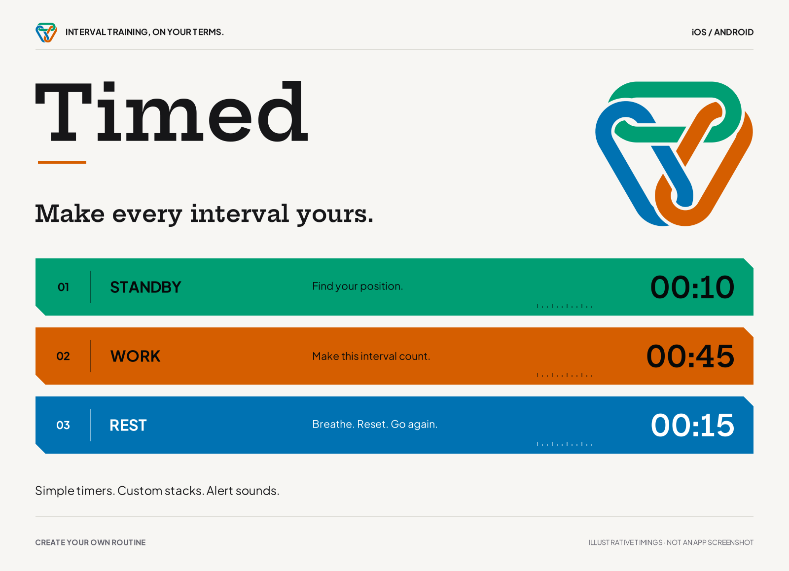
  </picture>
</a>

**Site:** [nuclearfessel.github.io/Timed](https://nuclearfessel.github.io/Timed/) · **Guide:** [Using Timed](https://nuclearfessel.github.io/Timed/guide.html) · **Releases:** [GitHub Releases](https://github.com/nuclearfessel/Timed/releases)

Timed is free. **iOS and Android only** — no web, desktop, Apple Watch, or Wear OS. No Pomodoro. No pre-built exercises.

## Screenshots

<p>
  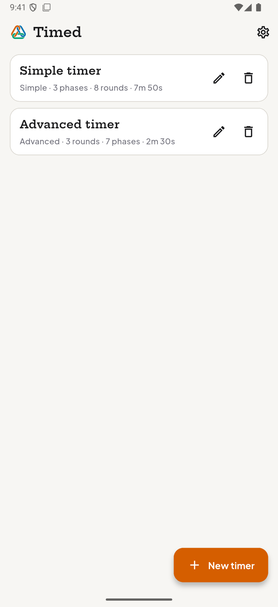
  &nbsp;
  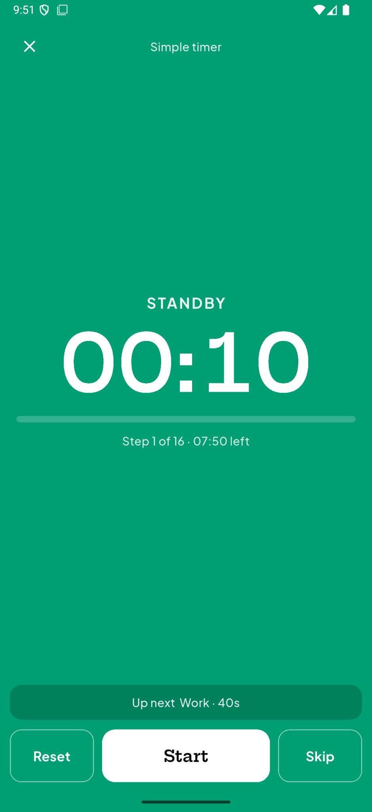
  &nbsp;
  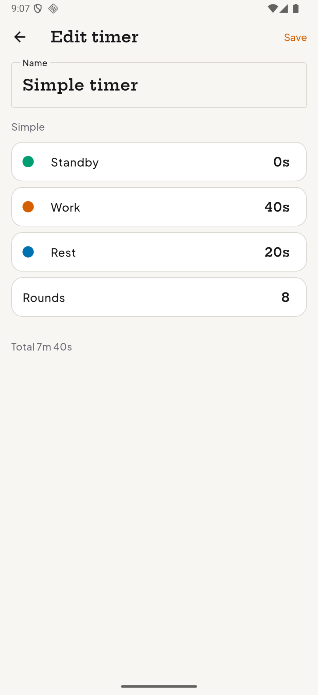
</p>

<p>
  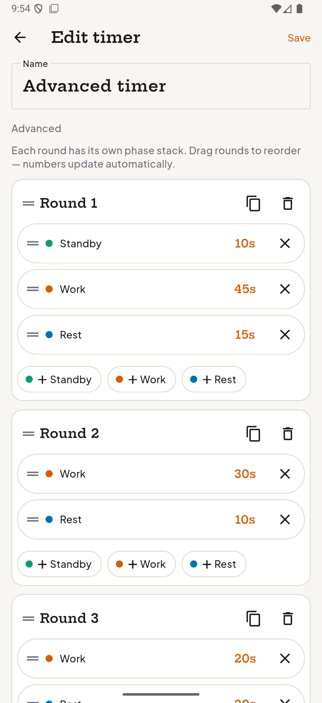
  &nbsp;
  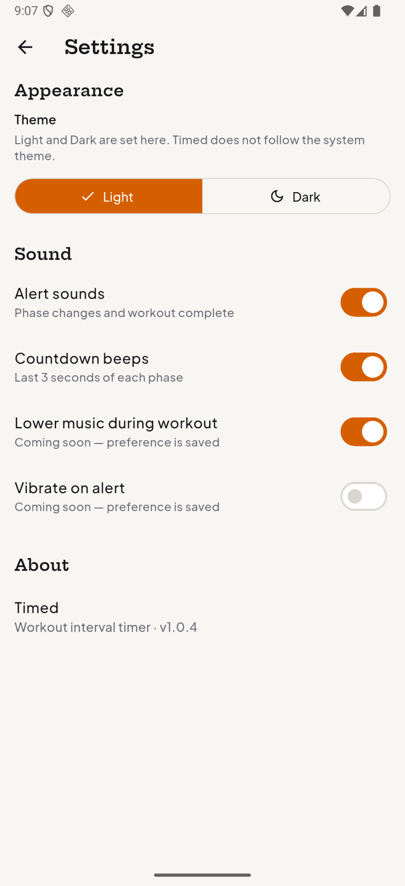
</p>

<p>
  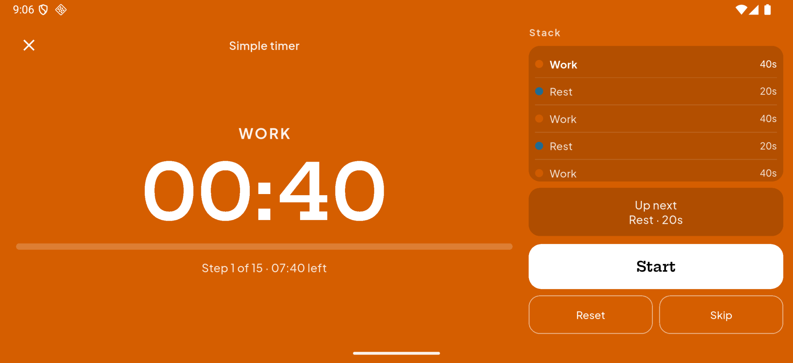
</p>

## Your session at a glance

Clear phase labels and countdown digits help you follow the session. The illustrated durations are examples, not preset workouts.

<p>
  <picture>
    <source media="(prefers-color-scheme: dark)" srcset="branding/Graphics/session-overview-dark.svg">
    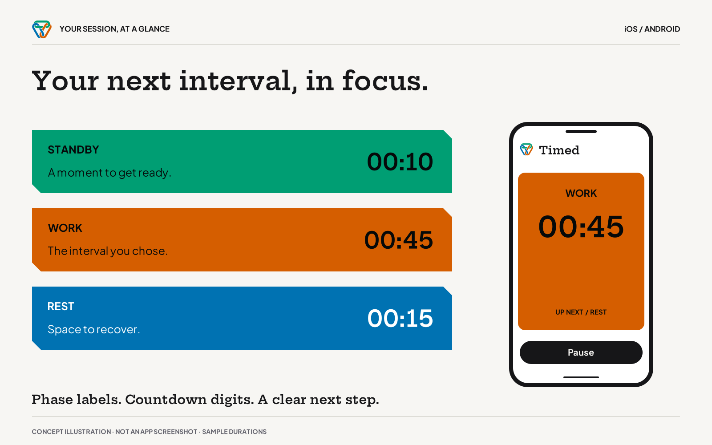
  </picture>
</p>

## Features

Create your own timers and sets. Choose simple rounds or build a custom sequence, then edit or delete routines as needed.

- Simple timers: standby, work, rest, rounds
- Advanced timers: rounds, each with its own standby / work / rest stack
- Full-screen phase colors and alert sounds
- Settings: Light / Dark appearance (not system), sound preferences
- Portrait and landscape for the whole app

<p>
  <picture>
    <source media="(prefers-color-scheme: dark)" srcset="branding/Graphics/features-dark.svg">
    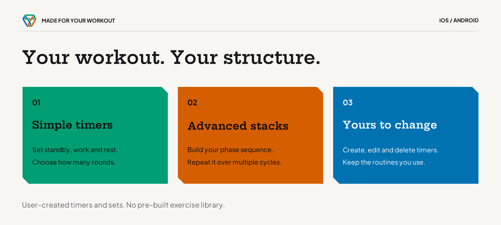
  </picture>
</p>

## Getting started

Choose Simple or Advanced, configure the timer and start. See the [guide](https://nuclearfessel.github.io/Timed/guide.html) for full instructions.

<p>
  <picture>
    <source media="(prefers-color-scheme: dark)" srcset="branding/Graphics/workflow-dark.svg">
    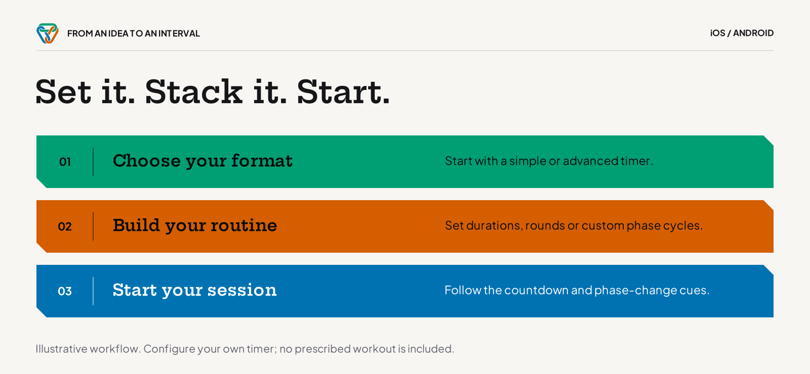
  </picture>
</p>

## Two timer formats

Simple timers run standby once, followed by work/rest rounds, with no rest after the final work interval. Advanced timers are a list of rounds; each round has its own phase stack, so later rounds can differ from earlier ones.

<p>
  <picture>
    <source media="(prefers-color-scheme: dark)" srcset="branding/Graphics/timer-types-dark.svg">
    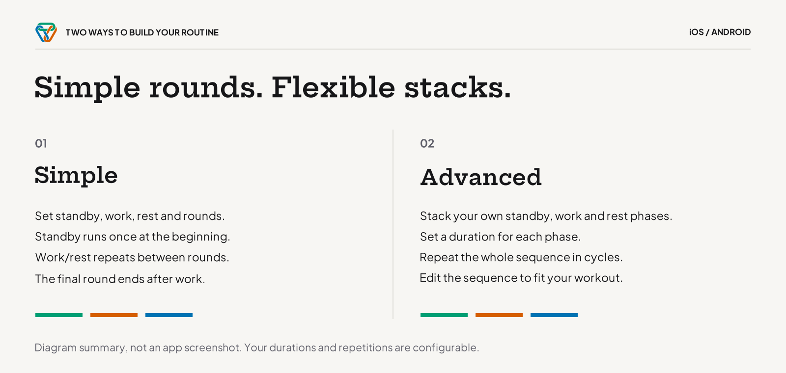
  </picture>
</p>

## Phase cues

Phase labels and sounds accompany the color cues; meaning does not depend on color alone. Standby is green, work is orange, rest is blue.

<p>
  <picture>
    <source media="(prefers-color-scheme: dark)" srcset="branding/Graphics/phases-dark.svg">
    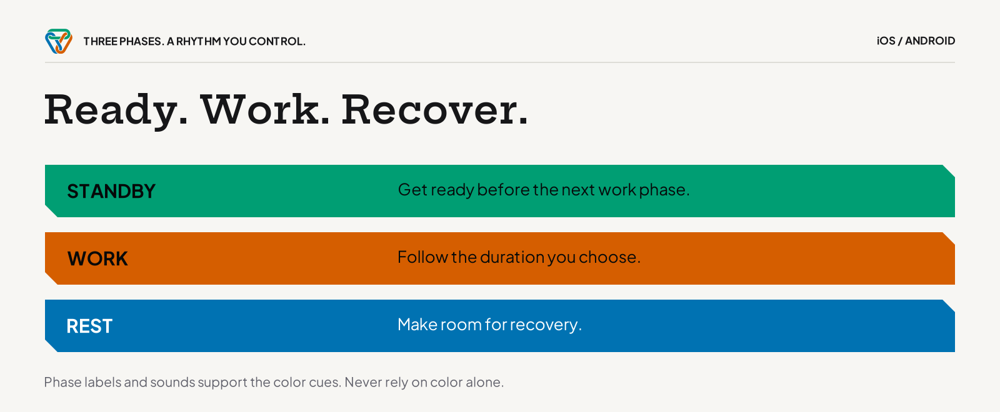
  </picture>
</p>

## Run controls

Start a session, pause and resume it, skip to the next phase or reset to the first phase.

<p>
  <picture>
    <source media="(prefers-color-scheme: dark)" srcset="branding/Graphics/run-controls-dark.svg">
    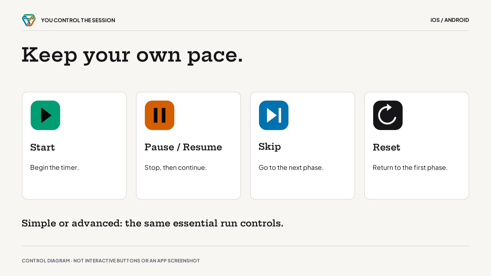
  </picture>
</p>

## Mobile platforms

Timed targets iOS and Android. Check [GitHub Releases](https://github.com/nuclearfessel/Timed/releases) and the [installation guide](https://nuclearfessel.github.io/Timed/guide.html#install) for current packages. iOS distribution requires signing on a Mac.

<p>
  <picture>
    <source media="(prefers-color-scheme: dark)" srcset="branding/Graphics/mobile-platforms-dark.svg">
    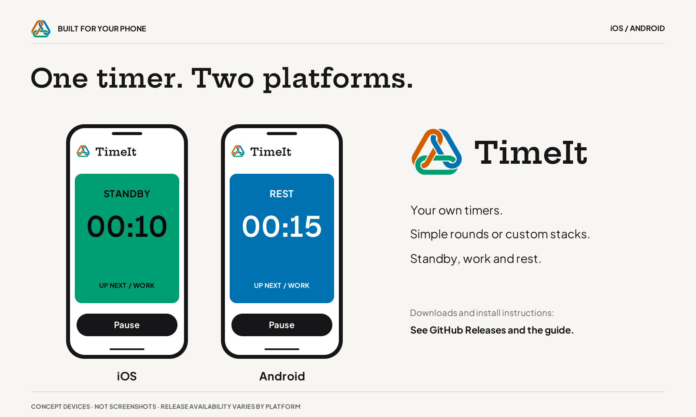
  </picture>
</p>

## Stack
- Flutter (one codebase → iOS + Android only)
- Fonts: **Hepta Slab** (digits / headers), **Plus Jakarta Sans** (UI)
- Brand mark: Interlocking Lanes

## Run
```bash
cd app
flutter pub get
flutter run
```

## Repo layout
- `app/` — Flutter app
- `docs/` — GitHub Pages site and guide
- `docs/assets/timed/` — public brand assets for Pages
- `branding/` — full brand package (icons sources, store art, guidelines)
- `docs/research.md`, `docs/reference-apps.md` — research notes
- `reference/index.html` — private screen reference board
- `AGENTS.md` — instructions for AI assistants continuing the work
